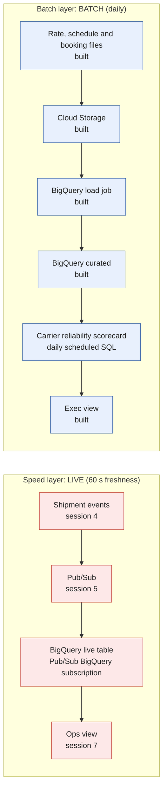

# Greenleaf Foods platform architecture

Launch customer SHP04. Targets: freshness 60 seconds, reliability 65% on time on every lane, budget $30 per month.

## Changes from the reference platform

- **Live (must meet 60 s):** shipment events, Pub/Sub, the BigQuery live table and the ops view.
- **Batch (daily is enough):** rate, schedule and booking files, Cloud Storage, the BigQuery load, curated tables, the scorecard and the exec view.
- **Crossed out: Kafka.** Pub/Sub already does the job, and Kafka would cost far more than the $30 budget.
- **Crossed out: Dataflow.** An always-on streaming job costs more than the budget on its own. A Pub/Sub BigQuery subscription writes events straight into BigQuery instead.
- **Crossed out: Dataproc.** The files are small (about 2 MB a month), so a BigQuery load job and SQL are enough.
- **Added: carrier reliability scorecard.** A daily scheduled query that gives on-time % per carrier per lane. Greenleaf's misses come from carrier choice (see docs/metrics.md).